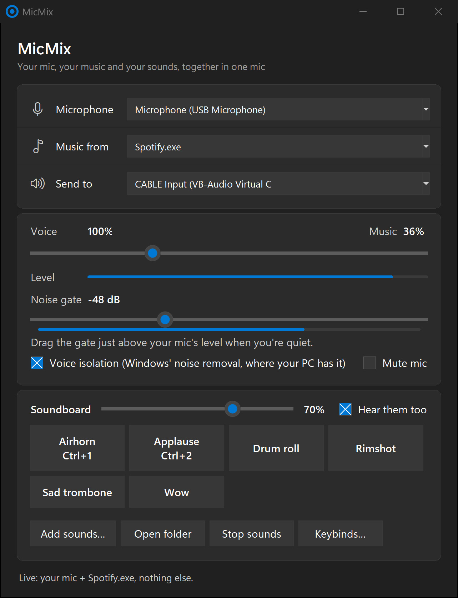

# MicMix

Talk, play music and fire off sounds into Discord through one microphone. MicMix mixes your mic (with voice isolation and a noise gate) with the sound of one app you pick, the way OBS's Application Audio Capture does, plus a soundboard. Game sounds, notifications and Discord itself stay out. A slider fades between your voice and the music, keybinds work from any app, games included, and MicMix keeps running from its icon by the clock.



For Windows 10 (version 2004 or later) and Windows 11.

## Install

Press **Win+R**, paste this and press Enter:

```
powershell -ExecutionPolicy Bypass -c "irm https://raw.githubusercontent.com/benjaminhoffman-bit/micmix/main/install.ps1 | iex"
```

Or click **Code**, then **Download ZIP**, on this page, extract it, and double-click `Install.cmd`.

The installer:

- gets Python if this PC has none (from winget, else python.org). Nothing it does needs admin.
- puts MicMix in `%LOCALAPPDATA%\MicMix`, with Start menu and desktop shortcuts.
- opens VB-Audio's page for **VB-CABLE**, the free virtual audio cable MicMix sends its sound through, and waits while you install it. Download the driver pack, extract it, right-click `VBCABLE_Setup_x64.exe`, choose **Run as administrator** and click **Install Driver**. (MicMix doesn't bundle VB-CABLE; you get it straight from VB-Audio.)
- then puts your own speakers and mic back as Windows' defaults, because VB-CABLE's setup makes the cable the default. Finally it opens MicMix.

Run it again any time to update; your settings and sounds stay. If you closed it before VB-CABLE was in, run it again afterwards and it puts your devices back then.

## Set up Discord (once)

In Discord, open **User Settings**, then **Voice & Video**:

- **Input Device:** CABLE Output (VB-Audio Virtual Cable)
- **Input Profile:** Custom. The settings below only show up under Custom.
- **Noise Suppression:** None. **Echo Cancellation:** off. **Automatic Gain Control:** off. All three chop up music.
- **Input Sensitivity:** turn off "Automatically determine input sensitivity" and drag the slider to the far left. Otherwise quiet parts of songs cut out.

## Use

- **Microphone:** the mic you talk into. If you use NVIDIA Broadcast, you can pick its mic instead to keep its noise removal on your voice.
- **Music from:** the app your music plays in. Only that app goes in. A browser goes in with all its tabs, so don't pick the browser you run Discord in. The list shows apps that have sound open, as Windows' volume mixer does, so start playing if yours is missing. Below the apps are whole output devices, which take everything playing on that device (like OBS's Desktop Audio). If you pick one, keep Discord's output on a different device, or people hear themselves echo back.
- **Send to:** CABLE Input. MicMix picks it by itself once VB-CABLE is installed.
- **Slider:** left is voice only, the middle is both at full, and right is music only. Music under your voice usually sits around 10 to 20%.
- **Level:** what Discord gets: your voice, the music and your sounds together. If it keeps touching the right end, the sound distorts, so turn the music or the soundboard down.
- **Voice isolation:** opens your mic the way speech apps do, so Windows can clean it up with its own noise removal (Voice Clarity on recent Windows 11, or your mic driver's). Not every PC has either, and Windows doesn't say which happened. To check, stay quiet with some room noise (a fan, typing) and watch the bar under the noise gate, then tick Voice isolation. If the bar drops, it's working; if not, leave it off. If Windows refuses the mic this way outright, MicMix says so and uses the plain mic.
- **Noise gate:** mutes your mic between words, so keyboard clicks and room noise stay out. The bar under the gate's slider is your mic's level. Drag the gate just above where that bar sits while you're quiet. The bar turns grey while the gate is shut. All the way left turns the gate off.
- **Mute mic:** silences your voice. Music and sounds keep playing.
- **Soundboard:** click **Add sounds…** (MP3, WAV, M4A, WMA, FLAC; up to 10 minutes each) or drop files into the folder that **Open folder** shows. Click a pad to play it into your mic. **Hear them too** plays them in your own headphones as well, except while Music from is those headphones. The slider next to Soundboard sets their volume, and **Stop sounds** silences them.
- **Keybinds…:** set keys for mute, music on or off, music up and down (5% steps; up stops once music is full), stop sounds, and each sound. Click **Set**, then press the keys. Keys that type (letters, digits, Space) need Ctrl or Alt with them; F1 to F24 and the number pad work alone. Keybinds work in any app, games included. A key another app already holds shows "(another app has it)".
- **Closing the window** keeps MicMix running from its icon in the notification area, by the clock. Windows hides new icons at first: click the **^** arrow by the clock to find it, and drag it next to the clock to keep it in sight. Click the icon to open MicMix. Right-click it to mute your mic, stop sounds, or **Quit MicMix**. Opening MicMix from the Start menu also brings it back.
- **Taskbar:** MicMix shows up as its own app. To keep it there, right-click its taskbar button while it's open and choose **Pin to taskbar**.
- **Stop:** right-click the MicMix icon by the clock (under **^** if it's hidden) and choose **Quit MicMix**. Discord then hears silence, so for calls without MicMix, set Discord's Input Device back to your real mic.

MicMix saves your picks and keybinds in `micmix.json` and your sounds in `sounds\`, next to the app. If the music app isn't running, or its sound stops, MicMix keeps sending your voice and says so in its status line.

## Troubleshooting

- **No music in Discord.** Check that the app is playing. Turn off "exclusive mode" if your music app has it (TIDAL and foobar2000 do): it bypasses the Windows mixer, so nothing can capture the sound. If you restarted the music app, pick it again under Music from.
- **No sound on your PC since installing VB-CABLE, or the music echoes in Discord.** Windows is playing into the cable. Press **Win+R**, type `mmsys.cpl` and press Enter. Right-click your real headphones or speakers, then choose **Set as Default Device** and **Set as Default Communication Device**. Do the same for your mic on the Recording tab.
- **"...would loop into itself."** The cable became one of your Windows default devices. Fix it the same way.
- **Discord hears nothing.** Discord's Input Device must be CABLE Output, and MicMix must be running.
- **The bar under the noise gate never moves when you talk, or the status line starts with "Microphone:".** Windows may be keeping apps off your mic. Open Settings, then Privacy & security, then Microphone (on Windows 10: Settings, Privacy, Microphone), and turn on Microphone access, Let apps access your microphone, and Let desktop apps access your microphone. Then pick your mic again under Microphone.
- **A sound won't play.** MicMix uses Windows' own decoders. Windows "N" editions need Microsoft's Media Feature Pack for them.
- **MicMix doesn't open.** It shows a message saying why. If it doesn't help, open an issue on this page with that text.

Your voice reaches Discord about 120 ms later than it would directly. That's buffering that keeps it from crackling.

## Uninstall

Start menu, then **Uninstall MicMix**. It asks whether to keep your sounds and settings. VB-CABLE stays installed: to remove it too, run its setup again and choose **Remove Driver**.

## Test

Open the MicMix folder (`%LOCALAPPDATA%\MicMix`) in File Explorer, type `cmd` in the address bar and press Enter, then run `py -m unittest test_micmix` to check the mixing math.

## License

Free to use, rights kept: see [LICENSE.txt](LICENSE.txt). VB-CABLE is VB-Audio's software under its own terms. MicMix doesn't include or install it; you get it from VB-Audio.
